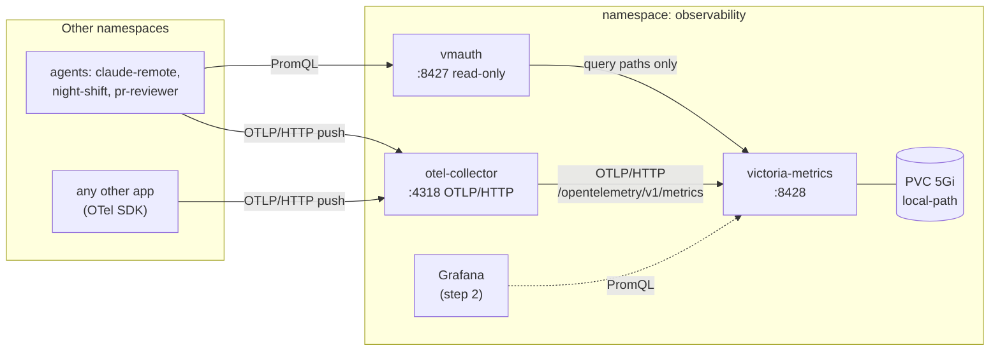

# observability: metrics for the cluster's agents

This namespace stores metrics that apps push to it. The first sender is Claude Code in claude-remote: sessions, tokens, cost, lines changed and code-edit decisions. Later the automated agents add their outcomes (the harness's `HARNESS_OUTCOME` per task, pr-reviewer's Job results).

## Why it exists

The agents run unattended, and today nothing records what they did or what it cost. With these metrics you can:

- see token use and cost per day, per model and per agent;
- see how often the agents run, and how often they fail or hit a limit;
- alert when claude-remote waits for setup or crash-loops (roadmap step 4).

Nothing in the cluster collected metrics before this. Three options were on the table (roadmap item *Observability*, 2026-11-01): in-cluster, Grafana Cloud, or alerts only. The owner chose in-cluster, so usage data stays home. The cost is 224 MiB of RAM requested (896 MiB at most) beside the game servers.

## Architecture



1. A sender pushes metrics over OTLP/HTTP (OpenTelemetry Protocol) to the collector. The collector is the only endpoint a sender knows: `http://otel-collector.observability.svc.cluster.local:4318`.
2. The collector limits its memory (`memory_limiter`), batches the data (`batch`) and forwards it, gzipped, to VictoriaMetrics' OTLP endpoint.
3. VictoriaMetrics stores each series on its volume for 90 days. It renames OTel metrics to Prometheus names: `claude_code.token.usage` (unit `tokens`) becomes `claude_code_token_usage_tokens_total`.
4. You read the data with PromQL (Prometheus Query Language). Agents and apps send queries to vmauth: `http://vmauth.observability.svc.cluster.local:8427`. vmauth passes only the query paths on to VictoriaMetrics, so a query client cannot write or delete data. Grafana reads the data from step 2.

| Part | File | What it is |
|---|---|---|
| Namespace | `namespace.yaml` | PodSecurity `restricted`. |
| Quota, LimitRange | `quota.yaml` | Caps CPU, memory, ephemeral storage and the PVC, so the namespace cannot starve the game servers. |
| NetworkPolicies | `networkpolicy.yaml` | Default deny. Allows DNS, pods in any namespace to the collector on 4318 and to vmauth on 8427, and the collector and vmauth to VictoriaMetrics on 8428. Nothing else. |
| VictoriaMetrics | `victoria-metrics.yaml` | Single-node v1.155.0, one replica, `Recreate`. 50m/128Mi requests, 500m/512Mi limits. Also scrapes its own metrics every 30 s. |
| OTel collector | `otel-collector.yaml`, `otel-collector-config.yaml` | Core distribution 0.164.0, metrics pipeline only. 20m/64Mi requests, 200m/256Mi limits. |
| vmauth | `vmauth.yaml`, `vmauth-config.yaml` | v1.155.0, VictoriaMetrics' proxy. Passes the read-only query paths only. 10m/32Mi requests, 200m/128Mi limits. |
| Egress allows | `../claude-remote/`, `../night-shift/`, `../pr-reviewer/` `networkpolicy.yaml` | `allow-observability`: the agents' pods may reach the collector and vmauth. |

Flux applies this directory from `main` through `nefcloud/kustomization.yaml`, as plain manifests. It is not a Flux app with its own repo: nothing here is built, and like `ops-broker/` it stays out of the agents' own repos.

## Design decisions

- **A collector in front of the database.** VictoriaMetrics' HTTP API has no authentication: anyone who reaches it can write or delete series. So senders never reach it; only the collector does. The collector also lets us change the backend, or add processing, without a change in any sender.
- **vmauth for queries.** Agents must run PromQL, but VictoriaMetrics serves queries, writes and deletes on the same port. vmauth is VictoriaMetrics' own proxy. Its config (`vmauth-config.yaml`) lists the query paths: `/api/v1/query`, `query_range`, `series`, `labels`, `label/<name>/values`, `metadata`, `status/tsdb` and `status/buildinfo`. It refuses every other path, for example `/api/v1/import`, `/opentelemetry/...`, `/api/v1/admin/tsdb/delete_series` and `/api/v1/export`. It also limits clients to 4 queries at a time. vmauth's own endpoints (`/-/reload`, `/flags`, `/metrics`) are on port 8426, and no NetworkPolicy opens it.
- **VictoriaMetrics, not Prometheus.** One small multi-arch binary with OTLP ingest, retention and a query UI built in. VictoriaMetrics' own benchmarks show it uses less RAM and disk than Prometheus for the same series. At our size (a few hundred series) both are small, so that is not the main reason. Both need cumulative counters from OTLP senders (see *Cumulative temporality*): Prometheus' OTLP receiver also cannot use delta sums without an experimental flag. So that limit does not favour either one.
- **Push first, scrape later.** Claude Code pushes OTLP, and pods with a short life (Jobs, the night-shift pod) finish before a scraper sees them. Scraping is not closed off: VictoriaMetrics can scrape Prometheus `/metrics` endpoints itself (`-promscrape.config`; it already scrapes itself). Nothing else is scraped yet. To scrape an app, add a scrape config and an egress allow from VictoriaMetrics to the app. Step 4 needs this for kube-state-metrics (pod states).
- **local-path storage, not Longhorn.** The data is useful but not critical, so it gets no replicas. local-path pins the volume to the node where the pod first starts, so the pod prefers any node other than shitbox and its game servers.
- **Cumulative temporality.** *Temporality* is not "temporary". It is how an OTel counter reports its value. *Cumulative* sends the total since the process started (10, 15, 22). *Delta* sends only the change since the last export (10, 5, 7). PromQL's `increase()` and `rate()` expect cumulative totals, and handle a reset to zero when the process restarts. VictoriaMetrics stores delta values as they come, and then those functions give wrong results. The core collector cannot convert delta to cumulative, so each sender must send cumulative. This is a permanent setting, not a stopgap. We can drop it only if we change to the contrib collector, whose `deltatocumulative` processor does the conversion.

## Send metrics from an app

The collector accepts pods from every namespace, so the observability side needs no change. In the app's namespace you need one or two changes:

**1. Let the app out.** Only if the app's namespace has a default-deny egress policy. The agents' namespaces (claude-remote, night-shift, pr-reviewer) already have this allow, `allow-observability`. ops-broker has default-deny egress too, and has no allow yet. This change is a NetworkPolicy, so the ops broker holds `human-review` on it for the owner.

A policy in observability cannot open this. Egress is decided by the policies in the sender's own namespace, so each default-deny namespace needs its own allow. Add it next to its other NetworkPolicies:

```yaml
---
apiVersion: networking.k8s.io/v1
kind: NetworkPolicy
metadata:
  name: allow-observability
  namespace: <app-ns>
spec:
  podSelector: {}
  policyTypes: [Egress]
  egress:
    - to:
        - namespaceSelector:
            matchLabels:
              kubernetes.io/metadata.name: observability
          podSelector:
            matchLabels:
              app.kubernetes.io/name: otel-collector
      ports:
        - {protocol: TCP, port: 4318}
    # Only if the app also queries metrics.
    - to:
        - namespaceSelector:
            matchLabels:
              kubernetes.io/metadata.name: observability
          podSelector:
            matchLabels:
              app.kubernetes.io/name: vmauth
      ports:
        - {protocol: TCP, port: 8427}
```

**2. Configure the sender.** Set these environment variables on the app's container. Every OTel SDK reads them:

```yaml
env:
  - {name: OTEL_SERVICE_NAME, value: <app>}
  - {name: OTEL_METRICS_EXPORTER, value: otlp}
  - {name: OTEL_EXPORTER_OTLP_PROTOCOL, value: http/protobuf}
  - {name: OTEL_EXPORTER_OTLP_ENDPOINT, value: "http://otel-collector.observability.svc.cluster.local:4318"}
  # Required: VictoriaMetrics needs cumulative sums (see Design decisions).
  - {name: OTEL_EXPORTER_OTLP_METRICS_TEMPORALITY_PREFERENCE, value: cumulative}
  # Only metrics have a pipeline here. Logs and traces have nowhere to go.
  - {name: OTEL_LOGS_EXPORTER, value: none}
  - {name: OTEL_TRACES_EXPORTER, value: none}
```

For Claude Code, also set `CLAUDE_CODE_ENABLE_TELEMETRY=1`. Its metrics are `claude_code.session.count`, `.token.usage`, `.cost.usage`, `.lines_of_code.count`, `.commit.count`, `.pull_request.count`, `.active_time.total` and `.code_edit_tool.decision`.

> [!WARNING]
> **Keep labels (attributes) low-cardinality.** Use a model name or an outcome. Never use a session ID, user ID, prompt, file path or timestamp. Each new label value makes a new series, and each series costs memory and disk for 90 days. A label with an unbounded set of values can fill the 5Gi volume and the 512Mi memory limit.
>
> Claude Code adds `session.id` to every metric by default. Set `OTEL_METRICS_INCLUDE_SESSION_ID=false` on it.

## Query the metrics

From any pod in the agents' namespaces (or any namespace without default-deny egress), send PromQL to vmauth. No kubectl and no port-forward:

```bash
Q=http://vmauth.observability.svc.cluster.local:8427/api/v1
# All metric names:
curl -s $Q/label/__name__/values
# Tokens per model over the last day:
curl -s $Q/query --data-urlencode \
  'query=sum by (model) (increase(claude_code_token_usage_tokens_total[1d]))'
# Series count per metric: watch cardinality.
curl -s $Q/status/tsdb
```

Queries use the Prometheus HTTP API, so the answers are JSON. VictoriaMetrics shows a sample about 30 s after it arrives (`-search.latencyOffset`).

**Check that data arrives.** VictoriaMetrics counts the OTLP rows it stores. This must go up after a sender starts:

```bash
curl -s $Q/query --data-urlencode \
  'query=sum(increase(vm_rows_inserted_total{type="opentelemetry"}[1h]))'
```

If it stays at 0, the sender's own log shows why. A connection timeout means a NetworkPolicy blocks it (step 1). An HTTP error from the collector means the collector refused the data. The collector's log (`kubectl -n observability logs deploy/otel-collector`) shows the export errors.

## Limits

- **Metrics only.** Claude Code sends per-tool decisions as events (OTel logs), and only `code_edit_tool.decision` is a metric. To count all tool decisions we need a logs backend (for example VictoriaLogs). That is the owner's decision.
- **No pod state yet.** The step 4 alerts (setup wait, crash loop) need pod-state metrics from kube-state-metrics or a kubelet scrape. Nothing provides them yet.
- **One replica each.** A collector restart drops the batch in memory; senders retry. A VictoriaMetrics restart pauses ingestion and queries for a few seconds. A vmauth restart pauses queries only.
- **The volume does not grow.** local-path cannot expand a PVC. 5Gi holds the Claude Code counters (a few hundred series) for 90 days many times over. More data means a new, larger PVC.
- **Quota.** `quota.yaml` has room for these three pods plus one surge pod each for the collector and vmauth during a rollout. Grafana (step 2) raises it.
- **Any pod can push and query.** The collector and vmauth accept pods from every namespace. Some of those pods run code we did not write: game servers, and the tests that pr-reviewer runs. Such a pod can send junk series, which costs disk until retention removes them, and can read the agents' usage data. It cannot delete or change stored data. If this becomes a problem, limit the senders to a namespace label.

## Roadmap

1. VictoriaMetrics and the collector (this directory).
2. Grafana behind oauth2-proxy, with VictoriaMetrics as its datasource.
3. All the agents send their metrics: Claude Code in claude-remote, the night-shift workers and the pr-reviewer Jobs. Their egress allows are already in place, so this step sets the env vars of *Send metrics from an app*, step 2, in each agent's own repo.
4. Alerts for setup wait, crash loops, and failed or `limited` agent runs.
