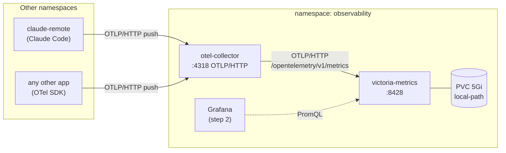

# observability: metrics for the cluster's agents

This namespace stores metrics that apps push to it. The first sender is Claude Code in claude-remote: sessions, tokens, cost, lines changed and code-edit decisions. Later the automated agents add their outcomes (the harness's `HARNESS_OUTCOME` per task, pr-reviewer's Job results).

## Why it exists

The agents run unattended, and today nothing records what they did or what it cost. With these metrics you can:

- see token use and cost per day, per model and per agent;
- see how often the agents run, and how often they fail or hit a limit;
- alert when claude-remote waits for setup or crash-loops (roadmap step 4).

Nothing in the cluster collected metrics before this. Three options were on the table (roadmap item *Observability*, 2026-11-01): in-cluster, Grafana Cloud, or alerts only. The owner chose in-cluster, so usage data stays home. The cost is 192 MiB of RAM requested (768 MiB at most) beside the game servers.

## Architecture



1. A sender pushes metrics over OTLP/HTTP (OpenTelemetry Protocol) to the collector. The collector is the only endpoint a sender knows: `http://otel-collector.observability.svc.cluster.local:4318`.
2. The collector limits its memory (`memory_limiter`), batches the data (`batch`) and forwards it, gzipped, to VictoriaMetrics' OTLP endpoint.
3. VictoriaMetrics stores each series on its volume for 90 days. It renames OTel metrics to Prometheus names: `claude_code.token.usage` (unit `tokens`) becomes `claude_code_token_usage_tokens_total`.
4. You read the data with PromQL (Prometheus Query Language), which VictoriaMetrics serves on `:8428`. Grafana does this from step 2.

| Part | File | What it is |
|---|---|---|
| Namespace | `namespace.yaml` | PodSecurity `restricted`. |
| Quota, LimitRange | `quota.yaml` | Caps CPU, memory, ephemeral storage and the PVC, so the namespace cannot starve the game servers. |
| NetworkPolicies | `networkpolicy.yaml` | Default deny. Allows DNS, and the collector to VictoriaMetrics on 8428. Nothing else. |
| VictoriaMetrics | `victoria-metrics.yaml` | Single-node v1.155.0, one replica, `Recreate`. 50m/128Mi requests, 500m/512Mi limits. Also scrapes its own metrics every 30 s. |
| OTel collector | `otel-collector.yaml`, `otel-collector-config.yaml` | Core distribution 0.164.0, metrics pipeline only. 20m/64Mi requests, 200m/256Mi limits. |

Flux applies this directory from `main` through `nefcloud/kustomization.yaml`, as plain manifests. It is not a Flux app with its own repo: nothing here is built, and like `ops-broker/` it stays out of the agents' own repos.

## Design decisions

- **A collector in front of the database.** VictoriaMetrics' HTTP API has no authentication: anyone who reaches it can write or delete series. So senders never reach it; only the collector does. The collector also lets us change the backend, or add processing, without a change in any sender.
- **VictoriaMetrics, not Prometheus.** One small multi-arch binary with OTLP ingest built in. It uses less memory and disk than Prometheus for the same data.
- **Push, not scrape.** Claude Code pushes OTLP. Pods with a short life (Jobs, the night-shift pod) also finish before a scraper sees them.
- **local-path storage, not Longhorn.** The data is useful but not critical, so it gets no replicas. local-path pins the volume to the node where the pod first starts, so the pod prefers any node other than shitbox and its game servers.
- **Cumulative temporality.** VictoriaMetrics stores delta sums as they come, and then `increase()` and `rate()` give wrong results. The core collector cannot convert delta to cumulative, so each sender must send cumulative.

## Send metrics from an app

You need three changes. The first two are NetworkPolicy changes, so the ops broker holds `human-review` on them for the owner.

**1. Let the app in.** In cluster-infra, add an ingress allow to `networkpolicy.yaml` in this directory. Replace `<app-ns>` with the app's namespace:

```yaml
---
apiVersion: networking.k8s.io/v1
kind: NetworkPolicy
metadata:
  name: allow-collector-from-<app-ns>
  namespace: observability
spec:
  podSelector:
    matchLabels:
      app.kubernetes.io/name: otel-collector
  policyTypes: [Ingress]
  ingress:
    - from:
        - namespaceSelector:
            matchLabels:
              kubernetes.io/metadata.name: <app-ns>
      ports:
        - {protocol: TCP, port: 4318}
```

**2. Let the app out.** If the app's namespace has a default-deny egress policy, add an egress allow next to its other NetworkPolicies:

```yaml
---
apiVersion: networking.k8s.io/v1
kind: NetworkPolicy
metadata:
  name: allow-otel-collector
  namespace: <app-ns>
spec:
  podSelector: {}
  policyTypes: [Egress]
  egress:
    - to:
        - namespaceSelector:
            matchLabels:
              kubernetes.io/metadata.name: observability
          podSelector:
            matchLabels:
              app.kubernetes.io/name: otel-collector
      ports:
        - {protocol: TCP, port: 4318}
```

**3. Configure the sender.** Set these environment variables on the app's container. Every OTel SDK reads them:

```yaml
env:
  - {name: OTEL_SERVICE_NAME, value: <app>}
  - {name: OTEL_METRICS_EXPORTER, value: otlp}
  - {name: OTEL_EXPORTER_OTLP_PROTOCOL, value: http/protobuf}
  - {name: OTEL_EXPORTER_OTLP_ENDPOINT, value: "http://otel-collector.observability.svc.cluster.local:4318"}
  # Required: VictoriaMetrics needs cumulative sums (see Design decisions).
  - {name: OTEL_EXPORTER_OTLP_METRICS_TEMPORALITY_PREFERENCE, value: cumulative}
  # Only metrics have a pipeline here. Logs and traces have nowhere to go.
  - {name: OTEL_LOGS_EXPORTER, value: none}
  - {name: OTEL_TRACES_EXPORTER, value: none}
```

For Claude Code, also set `CLAUDE_CODE_ENABLE_TELEMETRY=1`. Its metrics are `claude_code.session.count`, `.token.usage`, `.cost.usage`, `.lines_of_code.count`, `.commit.count`, `.pull_request.count`, `.active_time.total` and `.code_edit_tool.decision`.

Keep labels (attributes) low-cardinality: a model name or an outcome, never a session ID, user prompt or file path. Each new label value makes a new series.

## Check that data arrives

Until Grafana lands, port-forward to VictoriaMetrics (needs your kubectl, not the agents' read-only one):

```bash
kubectl -n observability port-forward svc/victoria-metrics 8428
# List all metric names:
curl -s localhost:8428/api/v1/label/__name__/values
# Tokens per model over the last day:
curl -s localhost:8428/api/v1/query --data-urlencode \
  'query=sum by (model) (increase(claude_code_token_usage_tokens_total[1d]))'
```

VictoriaMetrics also has a query UI at `http://localhost:8428/vmui` while the port-forward runs.

If nothing arrives, look at the collector's log (`kubectl -n observability logs deploy/otel-collector`). Export errors show there. A sender that the NetworkPolicy blocks gets a connection timeout in its own log instead.

## Limits

- **Metrics only.** Claude Code sends per-tool decisions as events (OTel logs), and only `code_edit_tool.decision` is a metric. To count all tool decisions we need a logs backend (for example VictoriaLogs). That is the owner's decision.
- **No pod state yet.** The step 4 alerts (setup wait, crash loop) need pod-state metrics from kube-state-metrics or a kubelet scrape. Nothing provides them yet.
- **One replica each.** A collector restart drops the batch in memory; senders retry. A VictoriaMetrics restart pauses ingestion for a few seconds.
- **The volume does not grow.** local-path cannot expand a PVC. 5Gi holds the Claude Code counters (a few hundred series) for 90 days many times over. More data means a new, larger PVC.
- **Quota.** `quota.yaml` has room for these two pods plus one collector surge pod during a rollout. Grafana (step 2) raises it.

## Roadmap

1. VictoriaMetrics and the collector (this directory).
2. Grafana behind oauth2-proxy, with VictoriaMetrics as its datasource.
3. claude-remote sends Claude Code's metrics (the steps in *Send metrics from an app*).
4. Alerts for setup wait, crash loops, and failed or `limited` agent runs.
